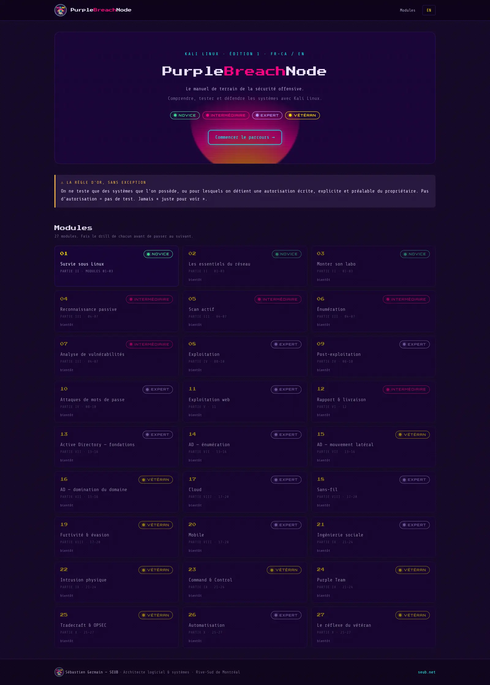
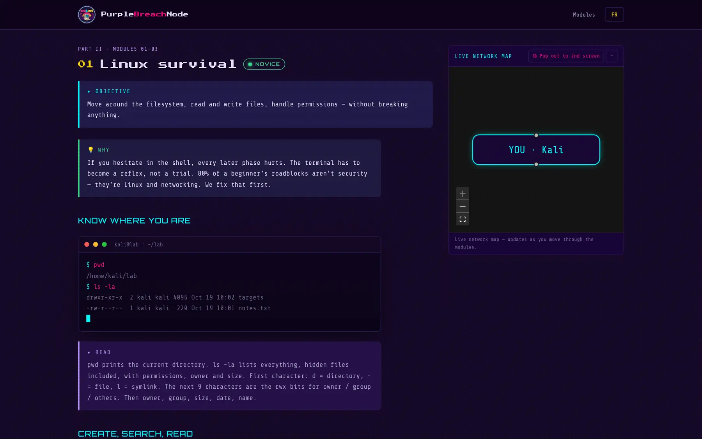

<div align="center">


# PurpleBreachNode

### The Offensive Security Field Manual · _Le manuel de terrain de la sécurité offensive_

```
            \     .   :   .     /
              '.  ╱▔▔▔▔▔▔▔╲  .'
          ______┤  s e u b  ├______
         ╱      '.╲▁▁▁▁▁▁▁╱.'      ╲
        ╱   .  :  '    │    '  :  .   ╲
     ═══╤═════╤═════╤══╧══╤═════╤═════╤═══
        │     │     │     │     │     │      synthwave // seub.net
     ───┴─────┴─────┴─────┴─────┴─────┴───
```

**Understand · test · and _defend_** systems with Kali Linux.
Pragmatic, terminal-veteran tone. Every offensive technique keeps its `REMEDIATION`.

<br/>


</div>

---

> ### ⚠ The golden rule, no exception
> You only test systems you **own**, or for which you hold the owner's **written,
> explicit, prior authorization**. No authorization = no test. Never _"just to see"_.

---

## ✦ Aperçu / Overview

PurpleBreachNode digitizes and translates an 85-page Kali Linux field manual into
a **bleeding-edge, bilingual (fr-CA / en)** documentation platform — not a PDF
dump, a purple-team command post.

<div align="center">

</div>

<table>
<tr>
<td width="50%"></td>
<td width="50%"></td>
</tr>
<tr>
<td align="center"><em>Lecteur de module (FR) + Live Network Map</em></td>
<td align="center"><em>Module reader (EN) + Live Network Map</em></td>
</tr>
</table>

## ✦ Stack (bleeding-edge only)

| Layer | Choice |
|------|--------|
| Meta-framework | **[TanStack Start](https://tanstack.com/start)** (Router + Query-ready) — SSR / SSG, file-based routing, streaming |
| Build | **Vite 8** + **TypeScript** (strict) — _no legacy CRA/SPA bundler anywhere_ |
| UI | **React 19** |
| Styling | **Tailwind CSS v4** (CSS-first `@theme`, first-party Vite plugin) |
| Graph | **[@xyflow/react](https://reactflow.dev)** (the engine behind BloodHound-style graphs) |
| State / sync | **Zustand** + **Broadcast Channel API** |
| Hosting | **Netlify** (static SSG) |

## ✦ Design system — "ApplePunk" / Synthwave

Charcoal & aubergine surfaces (`#140826` / `#1A053A`), neon **cyan** / **magenta**
/ **lavender** / **Dijon-gold** accents, carbon-fibre + honeycomb textures, CRT
scanlines. **No white. No navy.**

- **Titles / logos** — pixel type: `Press Start 2P`, `VT323`
- **Body / code** — technical mono: `Share Tech Mono`, `Orbitron`
- Tokens live in [`src/styles/app.css`](src/styles/app.css) (`@theme`); textures &
  keyframes in [`tailwind.config.ts`](tailwind.config.ts).

## ✦ Killer feature — `<LiveNetworkMap/>` / `<BreachTopology/>`

An interactive network topology that **grows as the reader advances**: IPs appear
during recon, a cyan reverse-shell line lights up at exploitation, targets turn
**magenta** on compromise, and the Active Directory _"shortest path to Domain
Admin"_ glows **red**.

It **pops out to a second screen** and stays in real-time sync with the main
window over the **Broadcast Channel API** — no server, no websocket. Terminal and
notes on screen one, live breach graph on screen two. A purple-team command post.

```
  main window  ──Broadcast Channel──▶  detached map (2nd screen)
   open module 08  ───────────────────▶  cyan shell edge, target → magenta
```

## ✦ Content model

Modules are authored as typed `ModuleDoc` objects
([`src/lib/content/types.ts`](src/lib/content/types.ts)) with bilingual `Bi`
strings. Native tooling / command names (`handshake`, `payload`, `pass-the-hash`,
`reverse shell`, `nmap`, …) stay **English in both locales** — only prose and box
labels (`WHY` / `TRAP` / `REMEDIATION` / `READ`) are translated. Each module may
carry `topology` mutations that drive the Live Network Map.

**Module 01** (`Survie sous Linux` / `Linux survival`) is fully authored EN+FR as
the reference implementation; the full **27-module roadmap** is scaffolded.

## ✦ Project layout

```
public/assets/brand/      optimized WebP logo / card / banner (seub.net)
src/
  routes/                 TanStack file-based routes
    __root.tsx            html shell, fonts, meta
    index.tsx             / → default locale
    $lang.tsx             locale layout (header, footer, map publisher)
    $lang/index.tsx       landing (hero, golden rule, 27-module roadmap)
    $lang/manual/$moduleId.tsx   module reader + MapDock
    map.$lang.tsx         detached pop-out map window
  components/ui/          Terminal · LevelBadge · Callout · ReadBox · BlockRenderer
  components/network/     BreachTopology · MapDock
  components/layout/      SiteHeader
  lib/i18n/               locales, box labels, lexicon rule
  lib/content/            content model (types) + modules/ registry
  lib/store/              breachStore (Zustand)
  lib/broadcast.ts        Broadcast Channel bridge + pop-out
  styles/app.css          root stylesheet (design tokens)
```

## ✦ Develop

```bash
pnpm install
pnpm dev        # http://localhost:3000  (routeTree.gen.ts is generated here)
pnpm typecheck
pnpm build      # SSG — prerenders every page (both locales) into dist/client
```

## ✦ Deploy — Netlify

The manual is fully prerendered, so it ships as a **static site** (no serverless
function). [`netlify.toml`](netlify.toml) sets `publish = "dist/client"` and
`command = "pnpm build"`.

[](https://app.netlify.com/start/deploy?repository=https://github.com/SEUB66/PurpleBreachNode)

Or via CLI:

```bash
netlify deploy --build --prod
```

---

<div align="center">


**Sébastien Germain — SEUB**
Architecte logiciel & systèmes · Rive-Sud de Montréal
[seub.net](https://seub.net)

```
        \   |   /
      .-"""""""-.
     (  s e u b  )   synthwave // seub.net
      '-.......-'
        /   |   \
```

— Seub G.

</div>
